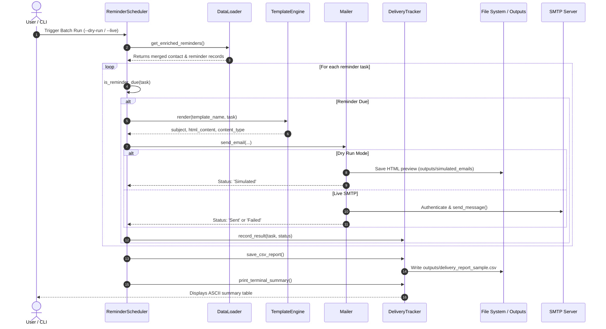

# System Architecture: Email Automation & Reminder System

## 1. High-Level Architecture Overview

The system is organized into modular layers following clean software engineering principles:

```
[ Contacts CSV ]       [ Reminders CSV ]       [ HTML/Text Templates ]
       │                      │                           │
       ▼                      ▼                           ▼
[ DataLoader ] ─────────► [ Join Engine ] ───────► [ TemplateEngine ]
                                                          │
                                                    (Personalized
                                                      Payload)
                                                          │
                                                          ▼
┌───────────────────────────────┐                  [ Mailer Engine ]
│       ReminderScheduler       │                         │
│  - Time-based comparator      │                         ├── [ Dry-Run Virtual Sim ]
│  - Interval polling loop      │                         │     └── Saves HTML previews
│  - Immediate batch dispatcher │                         │
└───────────────────────────────┘                         └── [ Live SMTP Sender ]
                                                                └── TLS/SSL to Gmail/Mailtrap
                                                                        │
                                                                        ▼
                                                             [ DeliveryTracker ]
                                                                        │
                                                ┌───────────────────────┴───────────────────────┐
                                                ▼                                               ▼
                                      [ Delivery Report CSV ]                         [ Audit Log File ]
                                    (outputs/delivery_report.csv)                   (logs/email_automation.log)
```

---

## 2. Component Breakdown

| Component | File | Responsibility |
| :--- | :--- | :--- |
| **Configuration** | `src/config.py` | Loads `.env`, handles fallback parsing, establishes base paths, configures logging. |
| **Data Loader** | `src/data_loader.py` | Ingests `contacts.csv` and `reminders.csv`, applies regex email validation, joins entities. |
| **Template Engine** | `src/template_engine.py` | Ingests `.html` and `.txt` files, substitutes `{placeholders}`, extracts subjects. |
| **Mailer** | `src/mailer.py` | Builds MIME messages (`EmailMessage`), executes safe offline simulation or live SMTP dispatch. |
| **Scheduler** | `src/scheduler.py` | Compares scheduled dates/times against reference clock, triggers batch or daemon loop. |
| **Tracker** | `src/tracker.py` | Records execution metrics, saves audit trails to CSV, prints terminal summary tables. |
| **Dashboard** | `src/dashboard.py` | Optional Streamlit web UI for visual monitoring, email previewing, and manual triggers. |
| **Entry Point** | `main.py` | CLI interface supporting `--dry-run`, `--live`, `--send-all`, `--loop`, and listing flags. |

---

## 3. Data Flow Diagram



---

## 4. Error Handling & Edge Cases

1. **Malformed Recipient Email**: Validated using RFC 5322 regex; marked as `Failed` in report with reason `Invalid recipient email format` rather than terminating the whole batch.
2. **Missing Template Placeholders**: Replaced gracefully with fallback values (`[key]`) to avoid runtime crashes.
3. **SMTP Authentication Failure**: Caught explicitly (`SMTPAuthenticationError`), logged with instructions to check Google App Passwords.
4. **Offline / Network Drops**: Handled with timeout-protected socket connections.
